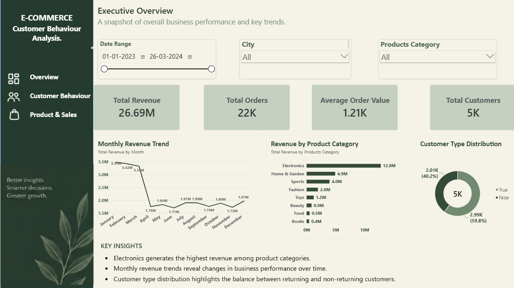
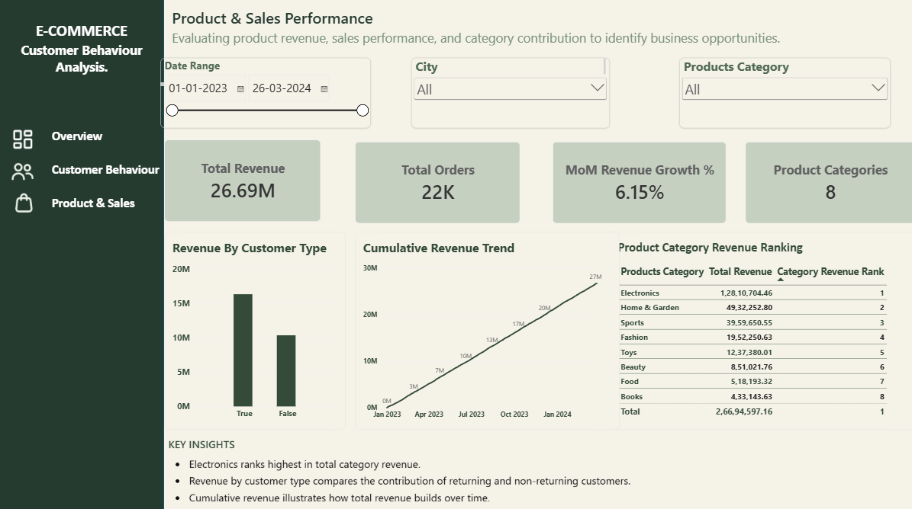
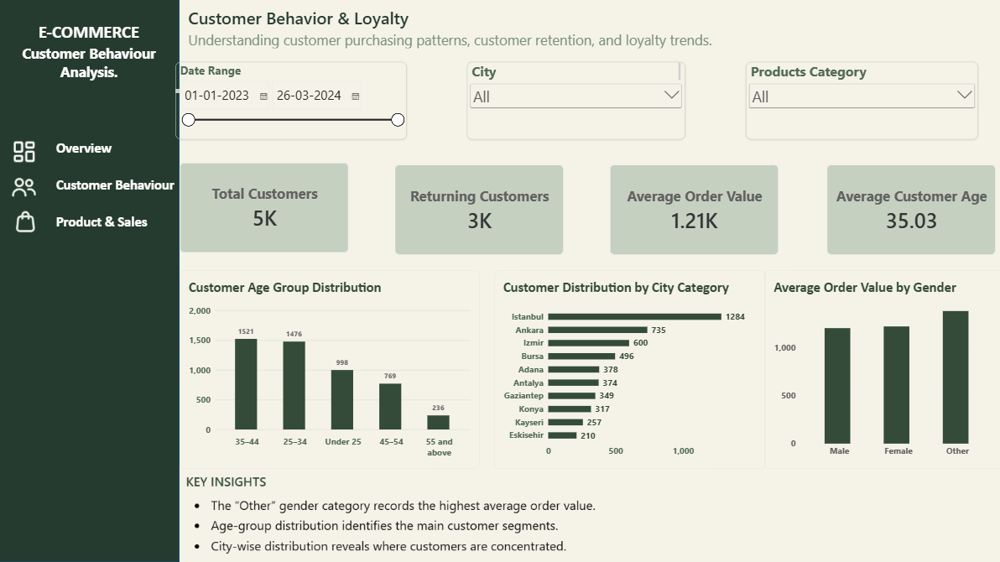

# Ecommerce-customer-behavior-analysis
Power BI project analyzing e-commerce sales performance, customer behavior, customer loyalty, and product category revenue through interactive dashboards and data-driven insights.

# E-Commerce Customer Behavior Analysis

## Project Overview

This project uses Microsoft Power BI to analyze e-commerce sales performance, customer demographics, purchasing behavior, and product category revenue. The goal is to transform raw data into meaningful insights that can support business decision-making.

The project includes three interactive dashboard pages designed to provide an overview of business performance, customer behavior, and product and sales performance.

## Objectives

- Analyze overall revenue, order volume, average order value, and customer count.
- Identify high- and low-revenue product categories.
- Understand customer distribution across age groups and cities.
- Examine returning-customer patterns and customer loyalty.
- Analyze revenue trends over time.
- Present key findings and business recommendations through interactive dashboards.

## Tools and Technologies

- **Microsoft Power BI** — Dashboard development and data visualization
- **Power Query** — Data cleaning and transformation
- **DAX** — Measures and calculations
- **Data Modeling** — Organizing transaction, customer, product, and date data

## Dashboard Pages

### 1. Executive Overview

Provides a snapshot of overall business performance through key performance indicators and visualizations.

Key metrics and analysis:
- Total Revenue
- Total Orders
- Average Order Value
- Total Customers
- Monthly Revenue Trend
- Revenue by Product Category
- Customer Type Distribution

### 2. Customer Behavior & Loyalty

Explores customer demographics, customer distribution, and purchasing patterns.

Key metrics and analysis:
- Total Customers
- Returning Customers
- Average Order Value
- Average Customer Age
- Customer Age Group Distribution
- Customer Distribution by City
- Average Order Value by Gender

### 3. Product & Sales Performance

Focuses on category performance, customer-type revenue, and cumulative revenue.

Key metrics and analysis:
- Total Revenue
- Total Orders
- Month-over-Month Revenue Growth
- Number of Product Categories
- Revenue by Customer Type
- Cumulative Revenue Trend
- Product Category Revenue Ranking

## Key Findings

- Electronics generated the highest revenue among the displayed product categories, at approximately 12.8 million.
- Books generated the lowest revenue among the displayed categories, at approximately 0.4 million.
- The 35–44 age group was the largest displayed customer segment.
- Istanbul had the highest customer count among the cities shown in the customer dashboard.
- The average order value varied across the gender categories in the dataset.
- Monthly and cumulative revenue visualizations provide different perspectives on business performance over time.

*Note: These findings reflect the displayed analysis. Lower revenue does not necessarily indicate a financial loss, and further cost and profit analysis would be required to assess profitability.*

## Business Recommendations

- Monitor demand and stock availability for high-revenue product categories.
- Test targeted promotions and product bundles to improve lower-revenue category performance.
- Use customer segmentation to develop relevant marketing strategies.
- Encourage repeat purchases through customer-retention initiatives.
- Monitor revenue, order volume, and monthly performance to support informed decisions.

## Interactivity

The dashboards include slicers for:
- Date Range
- City
- Product Category

These filters allow users to explore the data across different periods, locations, and product categories.

## Project Workflow

1. Imported the e-commerce datasets into Power BI.
2. Prepared and transformed the data using Power Query.
3. Appended the relevant datasets.
4. Organized the data model using transaction and dimension tables.
5. Created DAX measures for key performance indicators and analysis.
6. Developed interactive dashboards and interpreted the results.
7. Identified findings and formulated business recommendations.

## Project Files

The repository may include:
- Power BI report (`.pbix`)
- Dataset files (`.csv`), where permitted
- Dashboard screenshots
- Project documentation

## Conclusion

This project demonstrates the use of Power BI to analyze e-commerce data, explore customer behavior, compare product category performance, and communicate findings through interactive dashboards.

It provided practical experience in data preparation, data modeling, DAX calculations, data visualization, and business analysis.

## Author

**Shada Shamsheer**

B.Sc. Computer Science | Data Analytics

Skills: Power BI, Power Query, DAX, Data Visualization, Data Modeling, and Business Analysis
